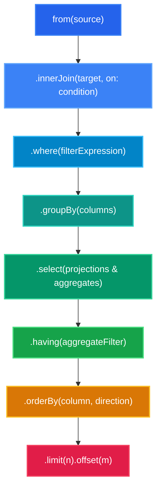

# ⚡ TTQL Developer Syntax Guide
### The Modern, Fluent Federated Query Language

Welcome to the **TableTalk Query Language (TTQL)** developer syntax guide. TTQL allows you to run single-script, read-only analytical queries across completely different databases (PostgreSQL, MySQL, MongoDB, Redis, SQLite, DuckDB, etc.) with zero glue code.

---

## 📑 Table of Contents
1. [⚡ 30-Second Cheat Sheet](#-30-second-cheat-sheet)
2. [🧩 Anatomy of a TTQL Pipeline](#-anatomy-of-a-ttql-pipeline)
3. [🌐 Environment & Constants](#-environment--constants)
4. [📍 Data Sources (`from`, `.as`)](#-data-sources-from-as)
5. [📋 Projections (`.select`)](#-projections-select)
6. [🔍 Filtering (`.where`)](#-filtering-where)
7. [🤝 Cross-Database Joins (`.innerJoin`, etc.)](#-cross-database-joins)
8. [📊 Grouping & Built-in Aggregations (`.groupBy`)](#-grouping--built-in-aggregations)
9. [🎛️ Post-Aggregation Filtering (`.having`)](#-post-aggregation-filtering-having)
10. [↕️ Sorting & Ordering (`.orderBy`)](#-sorting--ordering-orderby)
11. [📑 Pagination (`.limit`, `.offset`, `.skip`)](#-pagination-limit-offset-skip)
12. [💡 Pro Tips & Common Gotchas](#-pro-tips--common-gotchas)
13. [🍳 Ready-to-Use Recipes](#-ready-to-use-recipes)

---

## ⚡ 30-Second Cheat Sheet

```ttql
// 1. Declare connections & constants
const pg = environment.connections.ecommerce_pg;
const mysql = environment.connections.warehouse_mysql;
const activeStatus = 'completed';

// 2. Build the fluent query pipeline
from(pg.customers as c)
  .innerJoin(mysql.orders as o, on: c.id == o.customer_id)
  .where(c.country == 'US' && o.status == activeStatus)
  .groupBy(c.country, c.tier)
  .select([
    c.country,
    c.tier,
    count() as total_orders,
    sum(o.total_amount) as total_revenue,
    avg(o.total_amount) as average_ticket
  ])
  .having(total_orders >= 5 && total_revenue > 1000)
  .orderBy(total_revenue, 'DESC')
  .limit(20)
  .offset(0);
```

---

## 🧩 Anatomy of a TTQL Pipeline

Every TTQL query is a chainable, type-safe pipeline that flows from top to bottom.



### Method Execution Sequence
| Step | Method | Mandatory? | Purpose |
|:---|:---|:---:|:---|
| **1** | `from(dataSource)` | **Yes** | Roots the query on a primary database & table |
| **2** | `.innerJoin()`, `.leftJoin()` | No | Joins remote tables across any connection |
| **3** | `.where(...)` | No | Filters rows before grouping (pushed down natively) |
| **4** | `.groupBy(...)` | No | Partitions rows into aggregated buckets |
| **5** | `.select(...)` | No | Projects columns, aliases, and aggregates (defaults to `*`) |
| **6** | `.having(...)` | No | Filters grouped aggregate results |
| **7** | `.orderBy(...)` | No | Sorts the final result set |
| **8** | `.limit()`, `.offset()` | No | Paginates the output |

---

## 🌐 Environment & Constants

Declare target databases and reusable script variables at the top of your file with `const`.

### Connection Descriptors
Connections map directly to abstract names registered in your TableTalk configuration. Credentials and secrets are never in the script!

```ttql
const pg = environment.connections.production_postgres;
const mysql = environment.connections.warehouse_mysql;
const mongo = environment.connections.telemetry_mongo;
const redis = environment.connections.cache_redis;
```

### Literals & Constants
Constants can be strings, numbers, booleans, or lists:

```ttql
const minRevenue = 500.00;
const isVipCustomer = true;
const defaultCountry = 'US';
```

### The Spread Operator (`...`)
Lists can be declared once and unpacked into filters or projections with `...`:

```ttql
const priorityTiers = ['enterprise', 'vip', 'government'];
const userFields = ['id', 'username', 'email'];

from(pg.users)
  .select([...userFields, 'created_at'])
  .where(tier IN [...priorityTiers]);
```

---

## 📍 Data Sources (`from`, `.as`)

Every query starts with `from(...)`.

### Basic Table Reference
```ttql
from(pg.customers)
```

### Table Aliasing
You can alias tables inline or via `.as()`:

```ttql
// Inline 'as' keyword (recommended)
from(pg.customers as c)

// Method chaining
from(pg.customers).as('c')

// Bracket table access
from(pg.tables['customers'] as c)
```

---

## 📋 Projections (`.select`)

Controls which fields appear in your final output.

### 1. Comma-Separated or List Notation
```ttql
// Comma-separated arguments
from(pg.customers)
  .select('id', 'name', 'email');

// Array syntax
from(pg.customers)
  .select(['id', 'name', 'email']);
```

### 2. Output Aliasing (`as`)
Rename columns in the result set using `as`:

```ttql
from(pg.customers as c)
  .select([
    c.id as customer_id,
    c.full_name as client_name,
    c.email as contact_email
  ]);
```

### 3. Implicit Wildcard (`SELECT *`)
If you omit `.select(...)`, TTQL defaults to projecting all available columns from all tables:

```ttql
// Returns all columns from customers matching the filter
from(pg.customers)
  .where(status == 'active');
```

---

## 🔍 Filtering (`.where`)

TTQL compiles `.where(...)` expressions and automatically pushes them down to native database queries (e.g. `$1` SQL parameters or MongoDB MQL `$match` filters).

### Comparison Operators

| Operator | Alt | Meaning | Example |
|:---:|:---:|:---|:---|
| `==` | `=` | Equal | `status == 'active'` |
| `!=` | `<>` | Not Equal | `tier != 'free'` |
| `<` | | Less than | `balance < 100` |
| `<=` | | Less than or equal | `score <= 50.0` |
| `>` | | Greater than | `amount > 250` |
| `>=` | | Greater than or equal | `age >= 18` |
| `LIKE` | | Pattern match (`%` wildcard) | `email LIKE '%@acme.com'` |
| `NOT LIKE` | | Negated pattern | `name NOT LIKE 'test_%'` |
| `IN` | | Set inclusion | `country IN ['US', 'CA', 'UK']` |
| `NOT IN` | | Set exclusion | `state NOT IN ['archived', 'deleted']` |
| `is null` | `== null` | Null check | `deleted_at is null` |
| `is not null`| `!= null` | Non-null check | `phone is not null` |

### Logical Conjunctions (`&&`, `||`, `!`)
Combine expressions with standard boolean operators:

```ttql
from(pg.orders as o)
  .where((o.status == 'shipped' || o.status == 'delivered') && o.total >= 100);
```

> [!TIP]
> Both developer symbols (`&&`, `||`, `!`) and SQL words (`AND`, `OR`, `NOT`) are fully supported. Use whichever style your team prefers!

### Table Qualifier Routing
In joined queries, qualify fields with the table alias. TTQL routes each filter to its target engine automatically:

```ttql
from(pg.customers as c)
  .innerJoin(mysql.orders as o, on: c.id == o.customer_id)
  .where(c.country == 'US' && o.status == 'pending');
  // ^ c.country pushes to Postgres, o.status pushes to MySQL!
```

---

## 🤝 Cross-Database Joins

Join tables residing in completely different database vendors.

```
PostgreSQL (customers)   ──┐
                           ├─► Ephemeral In-Memory SQLite ─► Joined Result
MySQL (orders)           ──┘
```

### Supported Join Methods
- `.innerJoin(target, on: ...)`
- `.leftJoin(target, on: ...)`
- `.rightJoin(target, on: ...)`
- `.fullOuterJoin(target, on: ...)`

### 1. Natural Equijoin Shorthand (`on: 'key'`)
When both tables share the same column name:

```ttql
from(pg.customers)
  .innerJoin(mysql.orders, on: 'customer_id');
```

### 2. Explicit Mismatched Key Predicates
When keys have different names across engines:

```ttql
from(pg.customers as c)
  .innerJoin(mysql.orders as o, on: c.id == o.client_id);
```

> [!NOTE]
> Operand orientation is automatic. Writing `c.id == o.client_id` or `o.client_id == c.id` works identically.

### 3. Multi-Engine Chaining (3+ Databases)
```ttql
from(pg.customers as c)
  .innerJoin(mysql.orders as o, on: c.id == o.customer_id)
  .leftJoin(mongo.user_telemetry as t, on: c.id == t.user_id)
  .leftJoin(redis.active_carts as r, on: c.id == r.customer_id);
```

---

## 📊 Grouping & Built-in Aggregations

Compute metrics across row partitions using `.groupBy()` and aggregate functions.

### Built-in Aggregate Functions

| Function | Signature | Description |
|:---|:---|:---|
| `count()` | `count()` or `count(*)` or `count(col)` | Row count in partition |
| `sum(col)` | `sum(numeric_column)` | Summation |
| `avg(col)` | `avg(numeric_column)` | Arithmetic mean |
| `min(col)` | `min(column)` | Smallest value |
| `max(col)` | `max(column)` | Largest value |

### Example: Summary Report
```ttql
from(pg.orders as o)
  .groupBy(o.status)
  .select([
    o.status,
    count() as order_count,
    sum(o.total_amount) as total_volume,
    avg(o.total_amount) as average_ticket,
    min(o.total_amount) as smallest_order,
    max(o.total_amount) as largest_order
  ]);
```

### Multi-Column Grouping
```ttql
from(pg.sales as s)
  .groupBy(s.region, s.department)
  .select([
    s.region,
    s.department,
    sum(s.revenue) as dept_revenue
  ]);
```

---

## 🎛️ Post-Aggregation Filtering (`.having`)

Use `.having(...)` to filter aggregate metrics *after* they are calculated.

```ttql
from(pg.orders as o)
  .where(o.created_at >= '2026-01-01') // Pre-filter raw rows
  .groupBy(o.customer_id)
  .select([
    o.customer_id,
    count() as total_orders,
    sum(o.total_amount) as lifetime_spend
  ])
  .having(total_orders >= 5 && lifetime_spend >= 1000.00); // Post-filter groups
```

> [!IMPORTANT]
> Use `.where()` for filtering individual database rows before aggregation (saves network bandwidth!). Use `.having()` strictly for filtering computed metrics like `count()` and `sum()`.

---

## ↕️ Sorting & Ordering (`.orderBy`)

Sort your result set in ascending (`ASC`) or descending (`DESC`) order.

### Single Column Sort
```ttql
from(pg.users)
  .orderBy('created_at', 'DESC');
```

### Chained Multi-Column Sort
```ttql
from(pg.products)
  .orderBy('category', 'ASC')
  .orderBy('price', 'DESC');
```

### Inline Multi-Column Sort
```ttql
from(pg.products)
  .orderBy('category', 'ASC', 'price', 'DESC');
```

### Ordering by Aggregate Output Aliases
```ttql
from(pg.orders as o)
  .groupBy(o.customer_id)
  .select([
    o.customer_id,
    sum(o.amount) as total_spent
  ])
  .orderBy(total_spent, 'DESC'); // Orders by computed alias!
```

---

## 📑 Pagination (`.limit`, `.offset`, `.skip`)

TTQL provides deterministic pagination executed directly in the ephemeral SQLite staging database.

```ttql
from(pg.audit_events as a)
  .orderBy(a.timestamp, 'DESC')
  .limit(25)     // Take 25 rows
  .offset(50);   // Skip first 50 rows (Page 3)
```

> [!TIP]
> Both `.offset(n)` and `.skip(n)` are supported and interchangeable.

### Parameterized Pagination with Constants
```ttql
const pageSize = 20;
const pageNumber = 2;
const rowOffset = 20; // (pageNumber - 1) * pageSize

from(pg.customers)
  .orderBy('created_at', 'DESC')
  .limit(pageSize)
  .offset(rowOffset);
```

---

## 💡 Pro Tips & Common Gotchas

### 1. Read-Only Invariant
TTQL is strictly an analytical engine. Attempting to run mutations (`INSERT`, `UPDATE`, `DELETE`, `DROP`, `ALTER`, `TRUNCATE`) will immediately fail compilation with a `TtqlSecurityException`.

### 2. Disambiguate Column Names
When joining tables that share identical column names (like `id` or `created_at`), qualify them in your `.select()` or `.where()` clauses using their table alias:
```ttql
// Good: Disambiguated
c.id as customer_id, o.id as order_id

// Avoid: Ambiguous
id, id
```

### 3. Push Down Early
Filter rows in `.where()` rather than post-processing. TTQL automatically pushes `.where()` filters into the native SQL/MQL queries sent to Postgres, MySQL, or Mongo, minimizing network transfer.

---

## 🍳 Ready-to-Use Recipes

### Recipe 1: Cross-Engine Customer Order Summary (Postgres + MySQL)
```ttql
const pg = environment.connections.ecommerce_pg;
const mysql = environment.connections.inventory_mysql;

from(pg.customers as c)
  .innerJoin(mysql.orders as o, on: c.customer_id == o.client_id)
  .where(c.country == 'US')
  .groupBy(c.customer_id, c.full_name)
  .select([
    c.customer_id,
    c.full_name,
    count() as orders_placed,
    sum(o.total_price) as gross_merchandise_value
  ])
  .having(orders_placed >= 3)
  .orderBy(gross_merchandise_value, 'DESC')
  .limit(10);
```

### Recipe 2: Relational Customers + MongoDB Telemetry Sessions
```ttql
const pg = environment.connections.users_pg;
const mongo = environment.connections.telemetry_mongo;

from(pg.users as u)
  .innerJoin(mongo.sessions as s, on: u.id == s.user_id)
  .where(u.is_active == true && s.platform == 'ios')
  .select([
    u.id,
    u.email,
    s.session_id,
    s.duration_seconds
  ])
  .orderBy(s.duration_seconds, 'DESC')
  .limit(50);
```

### Recipe 3: Paginated High-Severity Audit Log
```ttql
const pg = environment.connections.security_pg;

from(pg.security_logs as s)
  .where(s.severity IN ['HIGH', 'CRITICAL'])
  .orderBy(s.logged_at, 'DESC')
  .limit(25)
  .offset(50);
```
